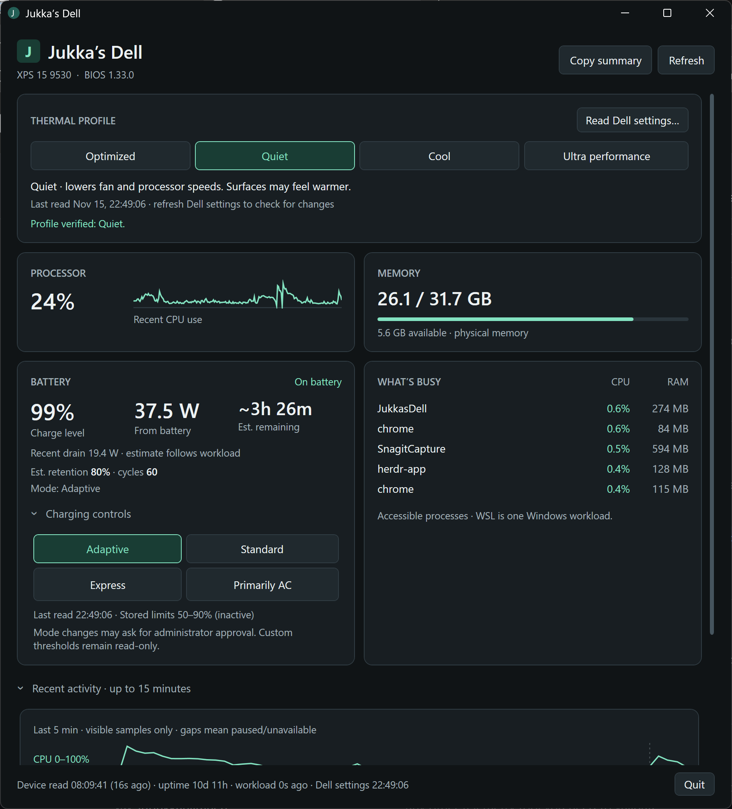

# Jukka’s Dell

A compact Windows utility for controlling Dell thermal and charging settings and keeping an eye on laptop workload and battery use.

Built for everyday use on a Dell XPS 15: switch to a quieter profile, see what is busy, check how quickly the battery is draining, and adjust charging behavior from one dark dashboard.

<p align="center">
  
</p>

## What it does

| Feature | What you can do |
| --- | --- |
| **Thermal profiles** | Switch between Optimized, Quiet, Cool and Ultra Performance using the profiles exposed by Dell firmware. |
| **Charging controls** | Choose Adaptive, Standard, Express or Primarily AC charging. See the last observed mode and any stored custom limits. |
| **Battery monitoring** | See charge level, watts flowing into or out of the battery, remaining capacity, estimated capacity retention and reported charge cycles. |
| **Runtime estimate** | Estimate remaining unplugged runtime from recent battery drain, with a short warm-up rather than an instant guess. |
| **Workload overview** | Follow CPU use and physical memory usage, and see the five busiest accessible processes by CPU. |
| **Recent activity** | Review up to 15 minutes of CPU and battery-power history, with markers for power-source changes, Dell-setting observations and monitoring pauses. |
| **Tray access** | Hide the window to the tray, reopen it quickly, and access Dell reads and thermal-profile changes from its menu. Monitoring pauses while hidden. |
| **Diagnostic summary** | Copy a timestamped text summary for troubleshooting, including readings, source failures and process names. |

The app shows when Dell settings were last read. It does not silently enforce a profile or assume another utility has left those settings unchanged.

## Getting started

The current version is **0.2.0**, a development build tested on **Windows 11 x64 with a Dell XPS 15 9530**. Other Dell models and firmware versions have not been validated; available settings and readings may differ.

To build from source, install Git and the **.NET 10 SDK for Windows**, then run these commands in Windows PowerShell:

```powershell
git clone https://github.com/jukkan/dell-jukka.git
cd dell-jukka
.\scripts\build.ps1
.\Launch.cmd
```

The default build includes the required .NET runtime. Keep the files in `artifacts\app` together if you copy the built app to another folder.

1. Open the app normally from `Launch.cmd` or `artifacts\app\JukkasDell.exe`.
2. Select **Read Dell settings…** to load the supported profiles and charging modes. Windows may ask for administrator approval.
3. Select a thermal profile, or expand **Charging controls** to change charging mode. Each setting change is read back before success is reported.
4. Expand **Recent activity** to inspect the timeline. Unplugged runtime appears after at least 16 seconds of valid, continuous discharge readings.

Closing or minimizing the window leaves the app in the tray. Use **Quit** to exit completely. Quit before rebuilding so the executable and DLLs are not locked.

## Understanding the readings

- **Battery watts describe battery flow**, not total laptop consumption or power drawn from the charger. The dashboard labels the direction; the timeline uses positive values for charging and negative values for discharge.
- **Runtime follows recent workload.** It uses remaining capacity and a smoothed recent-minute discharge average. It is unavailable while plugged in and needs fresh samples after pauses or missing readings.
- **Capacity retention is a firmware estimate**, not a battery diagnosis or prediction of remaining lifespan.
- **Missing data stays unavailable.** Some hardware and power states do not expose usable readings. Pauses and missing samples break the timeline rather than creating artificial measurements.

## Local operation and permissions

The dashboard runs as a normal user. On the tested laptop, Dell settings require administrator access even for reads, so the app starts a short-lived elevated helper only when requested. There is no persistent privileged service or recurring elevation prompt.

There is no cloud account, telemetry or automatic startup. Activity history stays in memory. Diagnostic exports include process names but omit serial numbers, service tags, account names, executable paths and command lines.

## Current limits

- Custom charging mode and charge start/stop thresholds are read-only.
- CPU temperature, fan RPM, GPU and SSD sensor monitoring are not integrated.
- There are no manual fan curves, automatic profile rules, BIOS updates or driver installation features.
- This is an unsigned development build, with validation concentrated on one laptop. Physical sleep/resume, standard-user UAC cancellation and longer-term behavior still need hands-on testing.

This is an independent personal project, not an official Dell application.

## Development

See the [development guide](docs/DEVELOPMENT.md) for architecture, source layout, command-line modes and tests; [VALIDATION.md](VALIDATION.md) for recorded checks and their limits; and the [changelog](CHANGELOG.md) for version history.
